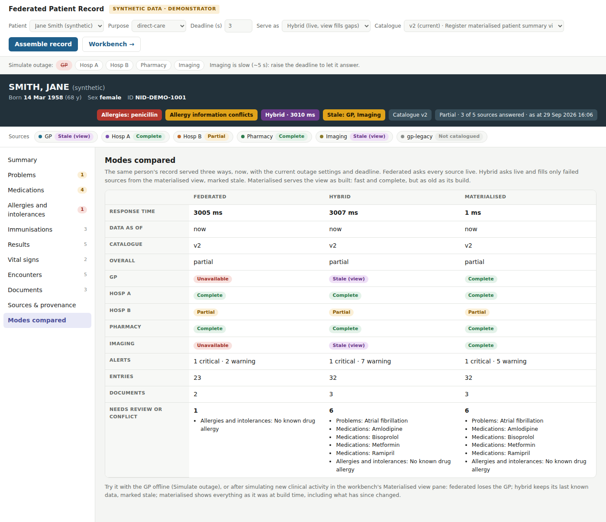
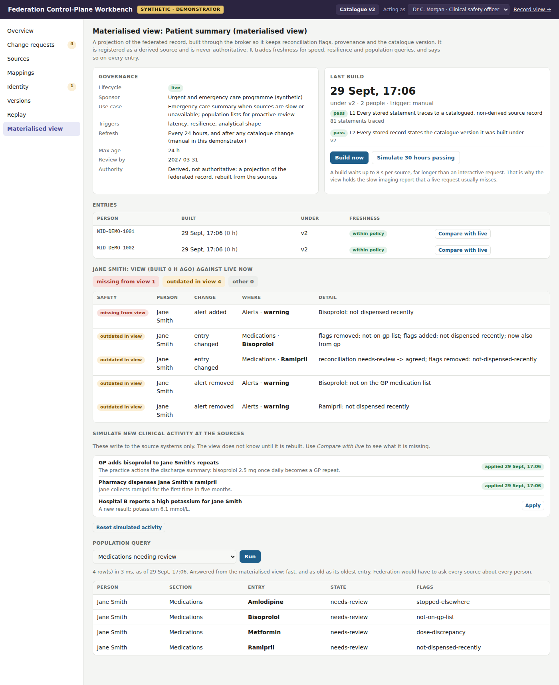

# Federated Hybrid Record

The fourth demonstrator for the *Metadata-Mediated Federated Health Data Architecture*. It completes the hybrid the design argues for: **live federation for fidelity, plus a governed materialised view for speed, resilience and population queries**, each honest about what it costs.

The first three demonstrators were pure federation, and they showed its weaknesses plainly: the slowest source sets the pace, an outage leaves a gap, and a question about a population means asking every source about every person. The design's answer is not to abandon federation. It is to add purpose-specific materialised views that the control plane itself registers, tests, versions and governs. This project builds that answer on top of the control-plane workbench.

> **Synthetic data only.** Every person, organisation, identifier, record and value is invented. SNOMED CT, ICD-10, Read v2 and LOINC codes are real codes used illustratively and must be verified before any real use. Medicine codes are placeholders for dm+d identifiers. Personas stand in for authenticated users. This is a demonstrator of architectural behaviour, not clinical software, and is not affiliated with any health service.



## What it shows

### 1. A materialised view is a source, and is governed like one

- A patient summary view arrives as an **onboarding pack** and becomes a change request in the workbench. It is **conformance-tested**, **impact-assessed** and **signed off** by the clinical safety officer before anything is built or served (P4). Before that, asking for it is refused.
- It is registered as a **derived** source. The catalogue records a **sponsor**, **use case**, the design's **materialisation triggers** (latency, resilience, analytical shape), a **refresh policy**, a **maximum age** and a **review date** (P5: model selectively). The conformance harness fails a view that lacks any of these, or that does not declare itself *not authoritative*.
- It is **never federated with its own originals**. The broker excludes derived sources from live federation, so nothing is counted twice.

### 2. It is built through the broker, so it keeps what makes the record trustworthy

The builder assembles each person's record through the same broker the clinician uses and stores the result. Every stored entry keeps its **reconciliation flags, provenance and lineage** to source records, and the **catalogue version** it was built under. Lineage checks run at every build.

The builder can wait **8 s per source**; an interactive request waits 3. So the view holds the slow imaging report that a live request usually misses: the latency trigger, made visible.

### 3. Three ways to serve the same record

| Mode | What it does | Gains | Costs |
|---|---|---|---|
| **Federated** | Asks every source now | Current; never stale | As slow as the slowest source; an outage is a gap |
| **Materialised** | Serves the view as built | About 1 ms; survives any outage; complete as of build | As old as its build; blind to anything since |
| **Hybrid** | Asks every source now, and fills **only failed sources** from the view, marked **stale** | Live where possible; no gaps | Stale parts must be read as stale |

With the GP offline, Jane Smith's record shows the difference starkly:

- **Federated** finds **1** issue needing review, because every GP-dependent discrepancy has vanished.
- **Hybrid** and **materialised** each find **6**.

In hybrid mode each affected entry is flagged *includes stale data*, with its age. Flags that assert something is missing (*not on the GP list*) state the age of the GP evidence they were judged against. This extends the second demonstrator's rule that absence needs a witness: here the witness is old, and the record says how old.

### 4. Staleness, stated and measured

- Every materialised record carries its **build time**, **age** and **catalogue version**. It is flagged **rebuild required** when it exceeds the maximum age, or when the catalogue has changed since it was built. Impact analysis in the workbench warns that applying any change will mark the view for rebuild.
- **Simulate new clinical activity** at the sources, for example the GP adding bisoprolol to repeats or the pharmacy dispensing ramipril. The view doesn't know. **Compare with live** shows exactly what it is missing and what it still shows that is no longer true:
  - **missing from view**: something a clinician would see live but not in the view. This is the safety risk of serving stale data.
  - **outdated in view**: something the view still shows that is no longer so.
- Rebuild, and it catches up.



### 5. The first population query

"Medications needing review across everyone" is answered from the view in milliseconds, stating the age of its oldest entry. Federation would have to ask every source about every person: the analytical-shape trigger, made visible.

## Quick start

Requires Python 3.10+.

```bash
python -m venv .venv
source .venv/bin/activate          # Windows: .venv\Scripts\activate
pip install -e ".[dev]"

fhr serve                          # record view http://127.0.0.1:8000/  ·  workbench http://127.0.0.1:8000/workbench
```

Two local stores are created on first start:

- `.fhr/controlplane.db`: catalogue versions, change requests and governance events. It holds no clinical content.
- `.fhr/views.db`: the materialised view. It **does** hold clinical content, which is why it is kept separate.

Reset both with `fhr reset`.

Other commands:

```bash
fhr demo                              # scripted walk-through: governance, then the materialised view (in memory)
fhr record --mode materialised        # Jane Smith from the view (register and build it first)
fhr record --mode hybrid
pytest -q                             # 47 tests
```

With Docker:

```bash
docker build -t federation-hybrid .
docker run -p 8000:8000 federation-hybrid
```

### A suggested walk-through

1. **Workbench → Materialised view**: it is not registered, so nothing can be built or served. Open the *summary-view* change request.
2. Run **conformance**: it warns that nothing is stored yet, and that the policy, derived status and purpose checks pass. Run the **impact analysis**. Sign off as the **clinical safety officer**.
3. **Materialised view → Build now**. Two people are built under the current catalogue, with lineage checks passing.
4. **Record view**: *Simulate outage → GP*. Switch **Serve as** between *Federated*, *Hybrid* and *Materialised*, then open **Modes compared**.
5. Back in the workbench, **apply** "GP adds bisoprolol" and "Pharmacy dispenses ramipril". Then use **Compare with live** for Jane Smith. **Build now**, and compare again.
6. **Simulate 30 hours passing**: the entries now show *rebuild required*. Approve any other change request: the view is marked for rebuild because the catalogue moved on.
7. Run the **population query**.

The governance scenarios from the workbench demonstrator (formulary code deprecation, identity confirmation, onboarding the archived practice system, replay) are all still here.

## How it is built

```
catalogue/, data/          Seed catalogue and synthetic source content
onboarding/summary-view.json   The view's onboarding pack: derived source with its materialisation policy
onboarding/gp-legacy.json      The archived practice system's pack (from the workbench demonstrator)
src/fhr/
  views/store.py          Data-plane store: current entry per person, build log
  views/service.py        Build through the broker; serve materialised; hybrid fallback;
                          freshness; compare with live; compare modes; population queries
  adapters/view.py        Adapter so the view can be conformance-tested like any source
  sources/events.py       Simulated new clinical activity at the sources
  broker.py               Derived sources excluded from federation; hybrid fallback hook; stale status
  controlplane/           Versioned control plane and governance (from the workbench),
                          plus derived-source conformance checks (C8–C10)
  static/index.html       Record view: serving mode, staleness, modes compared
  static/workbench.html   Workbench, with a Materialised view pane
tests/                    Governance, scenarios, materialised view, API
docs/design-notes.md      Design decisions and the mapping to the architecture
```

### Configuration

| Variable | Default | Purpose |
|---|---|---|
| `FHR_STORE` | `.fhr/controlplane.db` | Control-plane store |
| `FHR_VIEW_STORE` | `.fhr/views.db` | Materialised view store |
| `FHR_IMAGING_DELAY` | `5` | Seconds the imaging mock takes to answer |
| `FHR_AUDIT_FILE` | unset | Append broker audit events as JSON lines |
| `FHR_ROOT` | repository root | Where `catalogue/`, `data/` and `onboarding/` are found |

## Limits

- Refresh is manual. The policy says *every 24 hours and after any catalogue change*; a scheduler and change-triggered rebuilds are the obvious next step.
- The view is rebuilt whole. At scale it would be rebuilt incrementally from source change notifications.
- Freshness against live is checked on demand, per person. At scale it would be sampled.
- Hybrid fills a failed source with that source's statements from the last build. It does not try to reconcile the gap between that build and now; it only states the age.
- Personas are selected, not authenticated. Sources, the terminology server and the identity service are mocks.

## Uploading to GitHub

```bash
cd federation-hybrid
git init
git add .
git commit -m "Initial commit: federated hybrid record"
git branch -M main
git remote add origin https://github.com/<your-account>/federation-hybrid.git
git push -u origin main
```

The GitHub Actions workflow runs lint, the tests and the scripted demo on Python 3.10–3.12.

## Licence

MIT. See `LICENSE`.
